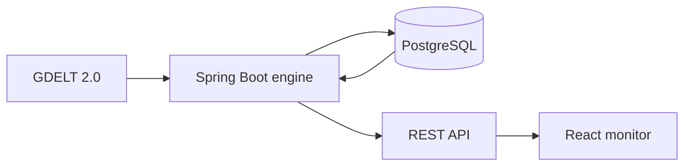

# Sentinel-GEM

**From global news signals to explorable stories.**

Sentinel-GEM continuously ingests [GDELT 2.0](https://www.gdeltproject.org/)
data, turns it into normalized articles and groups related reporting into
stories. A lightweight web monitor makes those stories easy to browse.

## What it does

- imports current GDELT event, mention and GKG data
- normalizes article URLs and combines their GDELT signals
- creates versioned story snapshots from title embeddings
- exposes articles, stories and pipeline health through a REST API
- presents story overviews and article details in a React monitor

## Architecture



| Component | Technology | Purpose |
|---|---|---|
| [`engine`](engine) | Java 21, Spring Boot 4 | ingestion, processing and REST API |
| [`monitor`](monitor) | React 19, TypeScript, Vite | story overview and details |
| PostgreSQL | PostgreSQL 17 | durable article, signal and story data |

## Quick start

You need [Docker](https://docs.docker.com/get-docker/) with Docker Compose.

1. Create your local configuration:

   ```powershell
   Copy-Item .env.example .env
   ```

2. Replace `change-me` in `.env` with a local database password. To generate
   story embeddings, also set `OPENAI_API_KEY`.

3. Start the complete system:

   ```powershell
   docker compose up --build -d
   ```

| Service | URL |
|---|---|
| Monitor | [http://localhost:5173](http://localhost:5173) |
| Engine API | [http://localhost:8080](http://localhost:8080) |

GDELT ingestion starts automatically and requires internet access. It can take
a few minutes before the first data appears.

Follow the services with `docker compose logs -f` and stop them with
`docker compose down`. Add `-v` only when you intentionally want to delete the
local database volume.

## Local development

Start only PostgreSQL from the repository root:

```powershell
docker compose up -d postgres
```

Then run the component you are working on:

```powershell
# Engine
cd engine
.\mvnw.cmd spring-boot:run

# Monitor (in a second terminal)
cd monitor
npm install
npm run dev
```

Run the checks before submitting a change:

```powershell
cd engine
.\mvnw.cmd verify

cd ..\monitor
npm run build
```

See the [engine guide](engine/README.md) and
[monitor guide](monitor/README.md) for component-specific configuration and
commands.

## Documentation

| Topic | Document |
|---|---|
| Architecture and product direction | [Platform architecture](docs/global_event_analysis_platform_architecture.md) |
| Article model and normalization | [Articles](docs/articles.md) |
| Story model and processing | [Stories](docs/stories.md) |
| Database structure | [Database overview](docs/database-overview.md) |
| Operations and troubleshooting | [Operations](docs/operations.md) |
| Ready-to-use API requests | [Postman collection](docs/postman) |

Engineering work is tracked in the
[Sentinel GEM team on Linear](https://linear.app/sentinel-gem/team/GEM).
